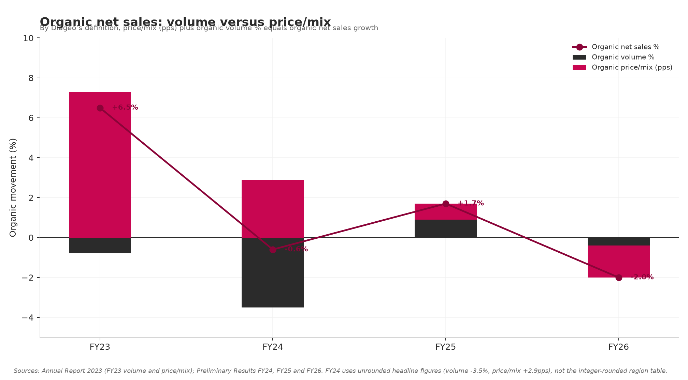
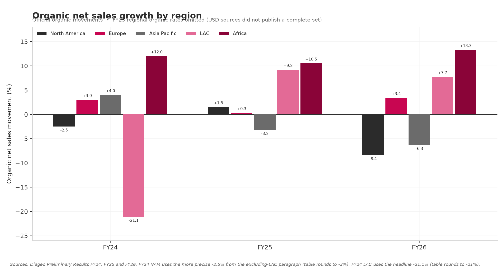
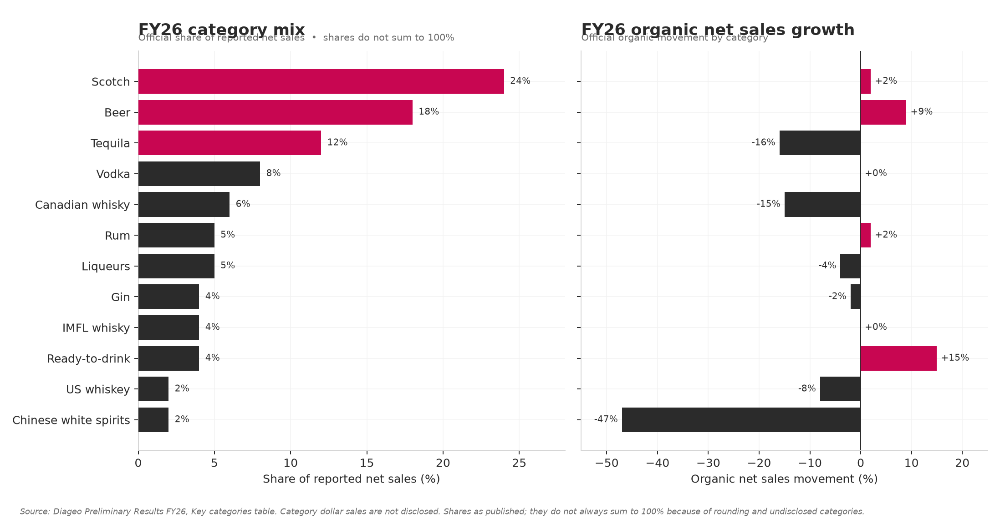
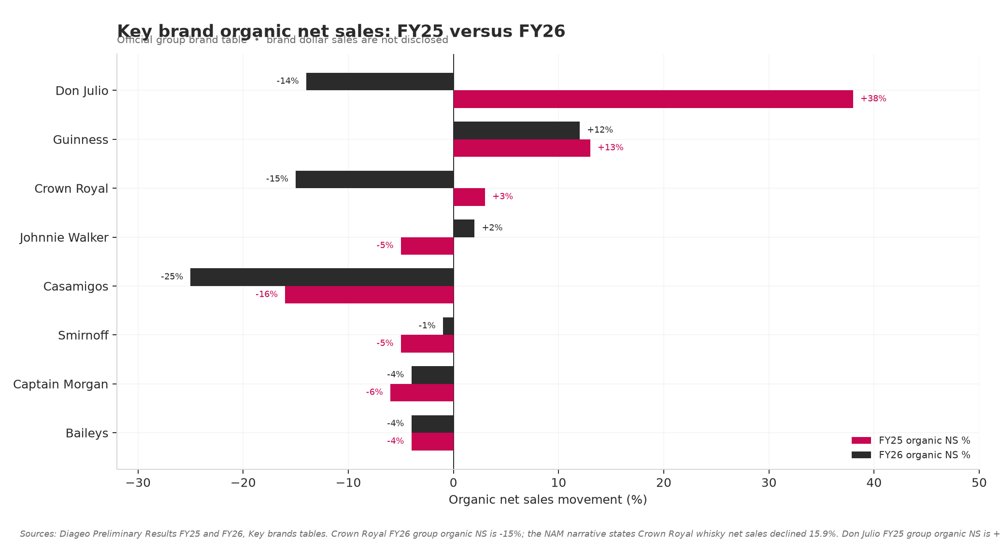

# Diageo Commercial Snapshot FY23–FY26

This report presents an independent commercial analysis of Diageo plc’s published results for the fiscal years ended 30 June 2023, 2024, 2025 and 2026. It was prepared by Rushabh Kabra as a portfolio project for a Commercial Analyst (Canada) role. The analysis asks where growth came from over the period and what that implies for revenue growth management (price, pack, mix, promotion and trade investment). Using only official disclosures, the work finds that group price/mix, which contributed +7.3pps in FY23, faded and turned to −1.6pps in FY26, leaving organic net sales at −2.0%; that North America, still 37% of FY26 net sales, was the principal drag; that growth in Europe, Latin America and Caribbean, and Africa offset declines in North America and Asia Pacific; and that Canada’s FY26 organic net sales of +7.7% include a one-off item. Interactive and static versions of the dashboard, the underlying data, and a short presentation accompany this report.

## Disclaimer

This is an independent analysis prepared solely from Diageo plc public disclosures (preliminary results and annual reports published on diageo.com). It is not affiliated with, endorsed by, reviewed by, or an official publication of Diageo. Diageo trademarks, brand names and logos belong to Diageo plc. This work is not investment advice.

## Live dashboard

The interactive dashboard is published on Tableau Public:

[Diageo Commercial Snapshot FY23–FY26](https://public.tableau.com/app/profile/rushabh.kabra3915/viz/DiageoCommercialSnapshotFY23-FY26/DiageoFY23-FY26CommercialSnapshot)

This repository also includes an Excel workbook (`excel/Diageo_Commercial_Dashboard.xlsx`), a ten-slide presentation in PowerPoint and PDF (`deck/`), and a Power BI-ready star schema (CSV files in `data/` and a build guide in `powerbi/`). Official source documents are listed in the [References](#references) section and in [SOURCES.md](SOURCES.md).

Chart images in `charts/` are Matplotlib exports of official figures. Blank or omitted values mean the figure was not printed in the source documents; nothing was estimated.



*Organic volume versus price/mix, FY23–FY26. Price/mix was the growth engine through FY23, then faded and turned negative in FY26.*



*Regional organic net sales. In FY26, growth in Europe, Latin America and Caribbean, and Africa offset declines in North America and Asia Pacific.*

## Business question and scope

**Business question.** Where did growth come from in FY23–FY26, and what does that imply for revenue growth management: price, pack, mix, promotion and trade investment?

**Scope.** Group, regional, category, brand and North America/Canada figures for the fiscal years ended 30 June 2023, 2024, 2025 and 2026, taken from Diageo plc preliminary results and annual reports published on diageo.com. The work is limited to what those public filings support. It does not use scan or depletion data, pack-level price architecture, promotional calendars, trade-spend ledgers, or a standalone Canada profit and loss, none of which are disclosed.

## Key insights

Six commercial observations, each tied to a cited official figure. Nothing here is estimated or invented.

1. **Price/mix, the FY21–FY23 growth engine, has reversed — RGM is the commercial priority again.** FY23 price/mix +7.3pps and organic net sales +6.5%; FY26 price/mix −1.6pps and organic net sales −2.0%. Sources: Annual Report 2023; Annual Report 2024; Preliminary Results FY24, FY25 and FY26. [[3]](#ref-3) [[5]](#ref-5) [[6]](#ref-6) [[2]](#ref-2) [[1]](#ref-1)

2. **North America, still more than a third of the group, is the drag.** NAM FY26: 37% of group net sales; organic net sales −8.4%; US Spirits organic net sales −11.5%; operating margin 35.9%. Sources: Preliminary Results FY24, FY25 and FY26. [[3]](#ref-3) [[2]](#ref-2) [[1]](#ref-1)

3. **Premiumisation in tequila and Crown Royal turned in FY26 — the cycle has two sides.** FY25 tequila organic net sales +18% and Crown Royal whisky net sales +3.8%; FY26 tequila organic net sales −16% and Crown Royal whisky net sales −15.9%. Sources: Preliminary Results FY25 and FY26. [[2]](#ref-2) [[1]](#ref-1)

4. **Guinness and beer have been the consistent growth engine across all three years.** Guinness organic net sales +15% / +13% / +12% (FY24–FY26); beer 18% of FY26 reported net sales. Sources: Preliminary Results FY24, FY25 and FY26. [[3]](#ref-3) [[2]](#ref-2) [[1]](#ref-1)

5. **Geographic diversification is doing real work: Europe, LAC and Africa offset NAM and APAC.** FY26 organic net sales: Africa +13.3%, LAC +7.7%, Europe +3.4%, APAC −6.3%, NAM −8.4%. Sources: Preliminary Results FY24, FY25 and FY26. [[3]](#ref-3) [[2]](#ref-2) [[1]](#ref-1)

6. **Canada is not just a NAM footnote — and FY26’s +7.7% includes a one-off.** Canada organic net sales: FY24 −2%, FY25 −0.9%, FY26 +7.7% (includes a one-off); FY26 organic volume −0.3%. Canada dollar sales are not disclosed. Sources: Preliminary Results FY24, FY25 and FY26. [[3]](#ref-3) [[2]](#ref-2) [[1]](#ref-1)

Supporting detail for each takeaway, including the fuller official commentary, sits on the Insights tab of `excel/Diageo_Commercial_Dashboard.xlsx`.



*FY26 category mix and organic growth. Published category shares of reported net sales do not sum to 100%; no category dollar sales were back-calculated from those shares.*



*Key brand organic net sales, FY25 versus FY26. Brand dollar sales are not disclosed. Several premium trademarks that grew in FY25 reversed in FY26; Guinness remained a consistent grower.*

## Methodology

A fuller methodology note sits on the Sources tab of `excel/Diageo_Commercial_Dashboard.xlsx`. The rules applied throughout this project are as follows.

- **Official figures only.** Every number traces to a Diageo preliminary results release or annual report listed in [References](#references) and [SOURCES.md](SOURCES.md). PDFs were downloaded from diageo.com on 12 November 2026. If a figure was not printed, the cell is left blank.

- **Organic versus reported.** Organic movements are non-GAAP measures as defined by Diageo (adjusting for exchange, acquisitions and disposals, and hyperinflation). They are not mixed with reported dollar growth, and organic growth is never recomputed from reported dollars. Price/mix is included only where Diageo printed it, not as organic net sales minus organic volume. Diageo defines price/mix as the number of percentage points difference between the organic movement in net sales and the organic movement in volume (FY25 prelim definition). Percentage movements in commentary are organic unless stated as reported.

- **No estimates.** Category and brand net sales in dollars are not disclosed and have not been back-calculated from rounded percentage shares. No Canada dollar sales have been implied.

- **Currency and restatement.** Diageo presents results in US dollars in the FY24–FY26 preliminary results. FY23 reported dollar figures and volumes used here are the re-presented comparatives printed in the FY24 preliminary results, not a currency translation performed for this project. FY23 organic growth rates (6.5%, volume −0.8%, price/mix +7.3pps) are taken from Annual Report 2023 and are currency-independent percentages. No pre-FY23 US dollar time series was constructed.

- **Calculated margins are labelled.** Operating margin is operating profit (or operating profit before exceptional items) divided by net sales, which is Diageo’s own definition. FY25 and FY26 reported and before-exceptional margin headlines are used as printed (21.4% / 28.2% and 16.1% / 28.9%). FY23 and FY24 margin levels are calculated from official profit and official net sales and are labelled as calculated. The FY24 official +262bps reported-margin movement is consistent with those calculated levels.

- **Rounding.** Where a document prints both a rounded table and a more precise headline (for example FY24 group organic net sales −0.6% versus a table of (1)%, or LAC −21.1% versus (21)%), the more precise official figure is used, and the notes column records the rounding.

## Challenges and resolutions

These are the substantive issues encountered while building the analysis from public filings. They are not claims about prior employment or unpublished results.

| Challenge | Impact | Resolution |
| --- | --- | --- |
| Presentation currency changed from pounds sterling to US dollars. Diageo’s FY23 statutory reporting was in GBP; from FY24, results are presented in USD. | A continuous reported-dollar series cannot be read straight from the FY23 annual report. FY23 category mix, most FY23 regional organic growth rates in USD, FY23 reported growth rates in USD, and any pre-FY23 USD time series are not available on a like-for-like basis. | FY23 reported dollar figures and volumes are the restated USD comparatives printed in the FY24 preliminary results, not a translation performed for this project. FY23 organic growth rates are taken from Annual Report 2023 and are currency-independent percentages. No pre-FY23 USD series was invented. |
| Organic and reported measures are not interchangeable. Organic net sales, volume and price/mix are non-GAAP; reported dollars include exchange, acquisitions, disposals and other items. | Treating a reported year-on-year percentage as an organic growth rate, or recomputing “organic growth” from reported dollars, would misstate the commercial picture. | The two families of measures are kept in separate fields. Charts and takeaways state which measure is shown. No organic growth measure is calculated as this year’s reported net sales divided by last year’s. |
| Category and brand dollar sales are not disclosed. Filings give category shares of reported net sales, official growth rates, and brand organic (and some reported) movements, but not absolute net sales in dollars for categories or brands. | Dollar league tables and contribution analyses by category or brand cannot be produced from public data without estimating. | Only the published shares and growth rates are used. Dollar amounts were not back-calculated from rounded percentages. |
| Published category shares do not sum to 100%. Official category shares of reported net sales are rounded and do not always add to 100. | Forcing a residual into a named category, or converting shares into dollars, would create a false sense of completeness. | Shares are shown as printed. The missing residual is left unallocated. It is not assigned to a category and is not converted into dollars. |
| Canada dollar sales are not disclosed, and the FY26 headline includes a one-off. Canada is reported inside North America. FY26 Canada organic net sales of +7.7% “includes a one-off item relating to a favourable resolution of commercial terms with a customer.” | The Canada commercial story cannot be sized in dollars, and the FY26 growth rate cannot be read as an underlying run-rate. | The official growth series is used, with the one-off flagged wherever the +7.7% appears. FY26 organic volume (−0.3%) is shown alongside it. No Canada dollar figure is implied. |
| Some regions have no printed price/mix in percentage points. Official organic price/mix in pps is not printed for Asia Pacific in FY25 and FY26, or for Africa in FY26. The documents describe the direction of mix but do not give a pps figure. | Completing the regional volume-versus-price/mix view by subtraction would invent a figure Diageo did not publish. | Those cells are left blank. Price/mix was not implied as organic net sales minus organic volume. |
| Power BI Desktop is Windows-only, and the free Power BI service generally requires a work or school email. | A native `.pbix` file could not be authored or published on the free Power BI service with a personal email address. | The interactive dashboard was published on Tableau Public (link above). A Power BI-ready star schema — dimension and fact CSVs in `data/` plus `powerbi/PowerBI_build_guide.md` — is included so the model can be rebuilt in Power BI Desktop. |
| Tableau Public web authoring offers only preset colour palettes. The in-browser editor does not accept an exact hexadecimal colour. | The published Tableau workbook cannot match Diageo pink (`#C80651`) precisely. | The closest preset pink was used on Tableau Public. The Excel workbook, chart PNGs and presentation use the exact brand colour. |

## Minor practical issues

Smaller process and presentation issues also had to be resolved, or in one case noted for a later clean-up.

- **Inconsistent category labels for ready-to-drink.** Source reports do not use a single spelling: FY24 and FY25 tables print “Ready to drink,” while the FY26 table prints “Ready-to-drink.” These were treated as the same category in the analysis. The data tables retain the official wording from each year’s report rather than overwriting it.

- **Corporate line in regional tables.** Official regional results tables include a Corporate line (reported net sales of $104m, $123m, $135m and $162m in FY23–FY26). Corporate is not an operating region and has no official share-of-net-sales headline. It is retained in the underlying dataset and excluded from the regional charts, which show only North America, Europe, Asia Pacific, Latin America and Caribbean, and Africa.

- **Google Drive could not overwrite a binary workbook in place.** A later revision of the Excel file could not replace the existing `.xlsx` on Google Drive, so the updated workbook was uploaded as a new file. The latest copy is the re-uploaded version.

- **Tableau Public layout needed a second pass.** The first published layout had a duplicated Measure Names legend, incomplete axis titles, and a size that did not sit on one screen. The workbook was re-saved at a fixed 1,200 × 800 pixels, with a single legend, a y-axis title of “pps / %,” and the disclaimer placed at the foot of the view.

- **Chart colours were restyled to the brand palette.** Early chart and workbook colours did not use Diageo’s published brand pink. The Excel dashboard, Matplotlib charts and presentation were restyled to `#C80651` (pink) with charcoal `#2B2B2B` and white, citing the public brand-colour references listed below. No Diageo logo is used, so as not to imply endorsement.

- **Leftover template metadata in the PowerPoint export.** The `.pptx` file retains generation-library properties in its document metadata (the title and author fields do not match the project). The accompanying PDF uses the project title and author. The metadata on the PowerPoint file should be cleaned before any wider circulation.

- **Rounding differences between reports.** The same movement sometimes appears as a precise headline and as a rounded table value (for example FY24 group organic net sales −0.6% versus (1)%, and LAC −21.1% versus (21)%). The more precise official figure is used, and the difference is recorded in the notes column of the workbook.

## Limitations and next steps

This analysis stops at what public filings support. It cannot see scan or depletion, pack-level price architecture, promotional depth, or trade investment by brand, customer or province. The following are hypotheses to test with internal data, not conclusions:

- **Price.** Whether list-price and pack-price architecture in US Spirits and Canadian whisky protected or eroded premium price points as price/mix turned negative.

- **Pack.** Whether pack-size mix (including value packs) contributed to the FY26 price/mix decline, and how pack architecture in Canada compares with the US.

- **Mix.** Whether the tequila and Crown Royal reversals were concentrated in specific brands, price tiers or customers, and how much of the group mix headwind was Chinese white spirits versus US Spirits.

- **Promotion.** Whether promotional intensity rose as volume came under pressure, and what that did to price/mix and margin.

- **Trade investment.** How trade spend, terms and programming moved in North America and Canada, including the FY26 Canada customer-terms item, and what the underlying run-rate looks like once that one-off is removed.

Internal sources that would be needed to test these include scan and depletion, account-level shipments, promotional calendars, trade-spend ledgers, and a Canada P&L that public filings do not provide.

Figures that could not be found in official sources, and were therefore left blank, are listed on the Sources tab of the workbook. They include category and brand net sales in dollars; Canada dollar sales, market share, category size and a standalone Canada P&L; FY23 category mix and most FY23 regional organic growth rates in USD; FY23 reported growth rates in USD; a complete USD time series before FY23; official organic price/mix in percentage points for Asia Pacific (FY25 and FY26) and for Africa in FY26; the FY26 results presentation PDF (the press-release PDF was found and used; presentation URL patterns tried returned no file); and organic operating profit growth and the organic operating margin level (as opposed to the bps movement) for FY23.

## References

Every figure in this repository traces to one of the official Diageo plc documents below. PDFs were downloaded from diageo.com on 12 November 2026. Brand-colour references were used only for visual styling.

1. <a id="ref-1"></a>Diageo plc, *Diageo Preliminary Results, year ended 30 June 2026* (6 August 2026). [PDF](https://www.diageo.com/~/media/Files/D/Diageo-V2/Diageo-Corp/press-release/2026/f26-preliminary-results-press-release.pdf); [web page](https://www.diageo.com/en/news-and-media/press-releases/2026/2026-preliminary-results-year-ended-30-june-2026).

2. <a id="ref-2"></a>Diageo plc, *Diageo Preliminary Results, year ended 30 June 2025* (5 August 2025). [PDF](https://www.diageo.com/~/media/Files/D/Diageo-V2/Diageo-Corp/press-release/2025/f25-preliminary-results-press-release.pdf); [web page](https://www.diageo.com/en/news-and-media/press-releases/2025/2025-preliminary-results-year-ended-30-june-2025).

3. <a id="ref-3"></a>Diageo plc, *Diageo Preliminary Results, year ended 30 June 2024* (30 July 2024). [PDF](https://www.diageo.com/~/media/Files/D/Diageo-V2/Diageo-Corp/press-release/2024/f24-prelims-results-press-release.pdf); [web page](https://www.diageo.com/en/news-and-media/press-releases/2024/2024-preliminary-results-year-ended-30-june-2024).

4. <a id="ref-4"></a>Diageo plc, *Diageo Annual Report 2025* (year ended 30 June 2025). [PDF](https://www.diageo.com/~/media/Files/D/Diageo-V2/Diageo-Corp/investors/results-reports-and-events/annual-reports/2025/annual-report-2025.ashx); [web page](https://www.diageo.com/en/investors/results-reports-and-events/annual-report-2025).

5. <a id="ref-5"></a>Diageo plc, *Diageo Annual Report 2024* (year ended 30 June 2024), Chief Executive’s statement. [PDF](https://www.diageo.com/~/media/Files/D/Diageo-V2/Diageo-Corp/investors/results-reports-and-events/annual-reports/diageo-annual-report-2024.pdf); [web page](https://www.diageo.com/en/investors/results-reports-and-events/annual-report-2024).

6. <a id="ref-6"></a>Diageo plc, *Diageo Annual Report 2023* (year ended 30 June 2023). [PDF](https://www.diageo.com/~/media/Files/D/Diageo-V2/Diageo-Corp/investors/results-reports-and-events/annual-reports/diageo-annual-report-2023.pdf); [web page](https://www.diageo.com/en/investors/results-reports-and-events/annual-report-2023).

7. <a id="ref-7"></a>ImgColorPicker, *Diageo brand colors*, https://imgcolorpicker.org/brand-colors/diageo/. Used for the pink `#C80651` styling of the Excel workbook, charts and presentation; not a source of financial figures.

8. <a id="ref-8"></a>BrandColor, *Diageo brand colors*, https://brandcolor.dev/brands/diageo. Used for the same visual styling as item 7; not a source of financial figures.

The FY26 results presentation PDF was not found (URL patterns tried returned no file). The FY26 preliminary results press-release PDF was found and used.

## Tools

Python (openpyxl, matplotlib), Excel, Tableau Public, and PowerPoint. AI-assisted tooling was used in preparing this project; all figures were checked against Diageo's published reports listed below.

## Repository structure

```text
.
├── README.md
├── LICENSE
├── SOURCES.md
├── requirements.txt
├── charts/                  # Matplotlib exports of official figures
├── data/                    # Power BI star-schema CSVs and Tableau data workbook
├── deck/                    # 10-slide presentation (PowerPoint and PDF)
├── excel/                   # Commercial dashboard workbook
├── powerbi/                 # Guide to rebuild the model in Power BI Desktop
└── scripts/                 # Generators for the Excel workbook and chart PNGs
```

To regenerate the Excel workbook or the chart PNGs from the official figures in `scripts/diageo_data.py`:

```bash
python -m pip install -r requirements.txt
python scripts/build_excel.py
python scripts/export_charts.py
```

Code in this repository is released under the MIT License. The figures themselves are taken from Diageo public disclosures; see [LICENSE](LICENSE).
